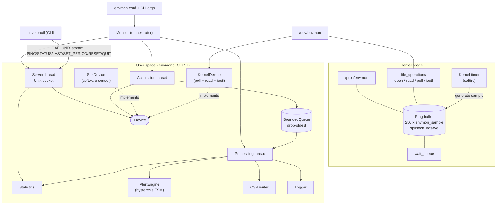

# Architecture Diagram

**Component responsibilities**

| Component | Responsibility |
|-----------|----------------|
| Kernel timer | Produces a sample every `period` ms; re-arms itself unless unloading |
| Ring buffer | Fixed 256-entry FIFO, overwrite-oldest, protected by an IRQ-safe spinlock |
| file_operations | The user ABI: blocking/non-blocking read, poll, ioctl |
| IDevice | Abstraction hiding kernel vs. simulated sensor |
| Acquisition thread | Waits for data (poll), batches samples into the queue |
| BoundedQueue | Decouples producer/consumer, bounds memory |
| Processing thread | Converts units, updates stats, runs FSM, writes CSV/log |
| AlertEngine | Per-metric hysteresis classification → overall state |
| Server thread | Parses one-line commands, returns text replies |
| Monitor | Owns device, queue, threads, lifecycle |
