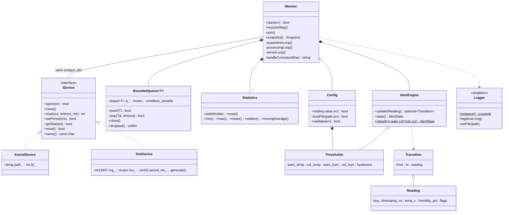

# Class Diagram (user space)

**Data structures**
- `envmon_sample` (kernel ABI, 24 bytes): `u64 timestamp_ns; s32 temp_mC; s32 humidity_mpct; u32 seq; u32 flags`.
- `envmon_stats`: `u64 generated, dropped; u32 buf_depth, period_ms`.
- Kernel ring: `struct envmon_sample ring[256]` with free-running `head`/`tail` (`count = head - tail`, index `& 255`; wrap-safe with unsigned arithmetic).
- User queue: `std::deque<envmon_sample>` capped at `queue_capacity`.
