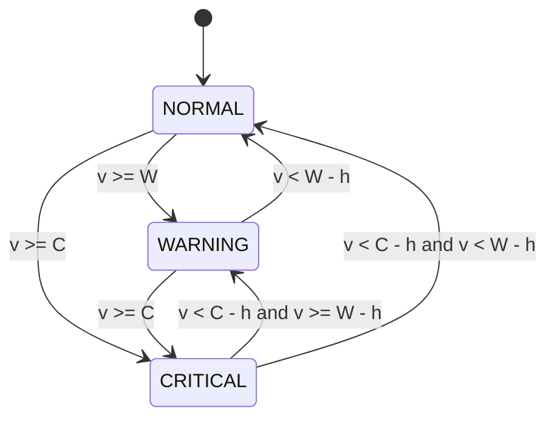
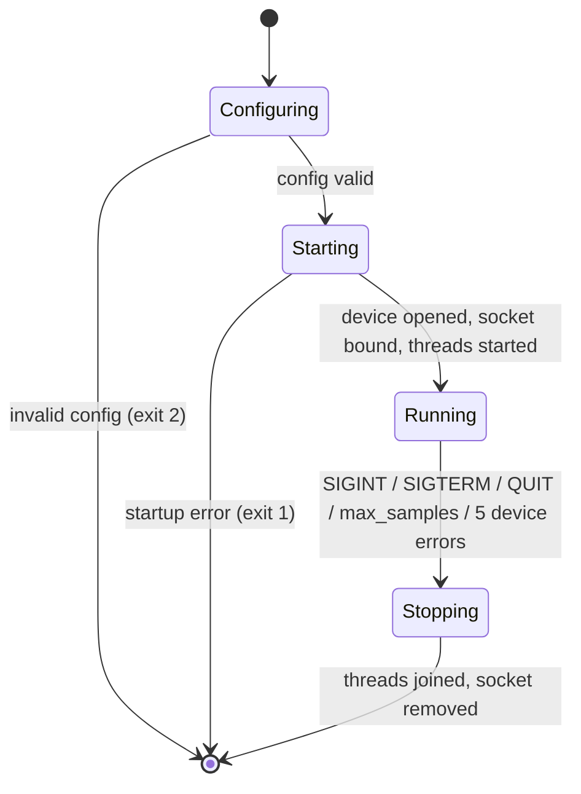
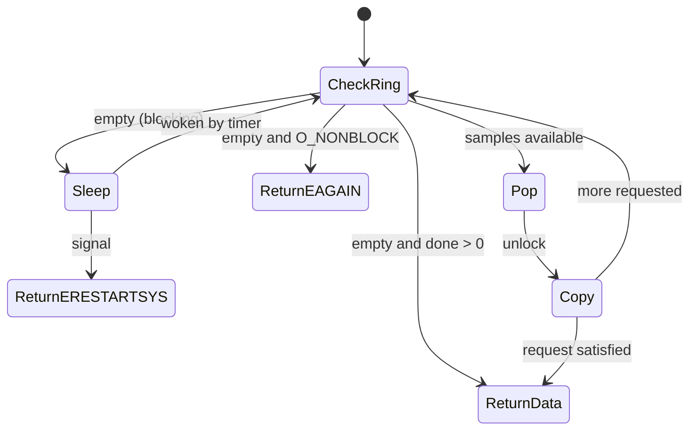

# State Machine Diagrams

## 1. Alert engine (per metric; overall state = worst of temperature/humidity)
`W` = warn limit, `C` = crit limit, `h` = hysteresis.

Between `W-h` and `W` (or `C-h` and `C`) the state is *held* – this removes flapping when a value hovers near a limit.

## 2. Daemon lifecycle

## 3. Driver read() path

